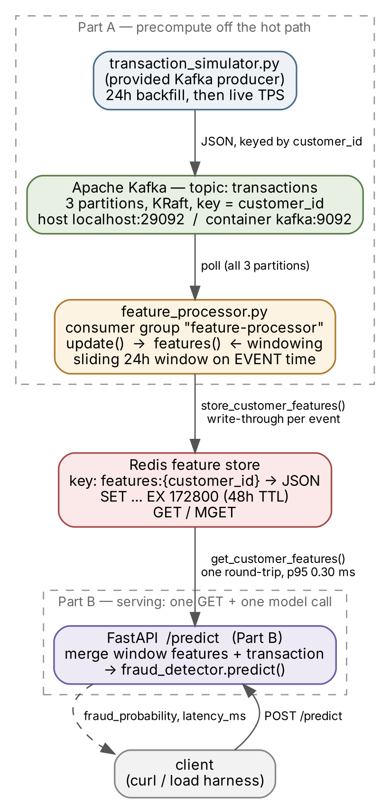

# TrustBank Real-Time Fraud Detection (DATA 789 Project 2)

Scores credit-card transactions in real time:
Kafka -> feature processor (24h sliding window) -> Redis feature store -> FastAPI model API.



## Run everything
Requires Docker Desktop.

```bash
docker compose up -d --build
docker compose ps          # 5 services; api shows (healthy)
```

| Service | What it does | Address |
| --- | --- | --- |
| kafka | event bus, topic `transactions` (3 partitions) | `kafka:9092` in containers, `localhost:29092` from host |
| redis | feature store, keys `features:<customer_id>`, 48h TTL | `redis:6379` / `localhost:6379` |
| simulator | 24h backfill + 5 min of live traffic at 50 TPS | - |
| feature-processor | consumes all partitions, writes windowed features | - |
| api | FastAPI model serving | http://localhost:8000 (docs at `/docs`) |

Re-send traffic: `docker compose start simulator`.

## API
| Endpoint | Purpose |
| --- | --- |
| `GET /health` | liveness (used by the Docker HEALTHCHECK) |
| `GET /model/info` | loaded model version |
| `GET /features/{customer_id}` | features currently stored in Redis |
| `POST /predict` | score one transaction; returns probability, label, latency_ms |
| `POST /predict_batch` | score a list; one Redis MGET for all customers |

Example body: see `tests/fixtures/predict_sample.json`. A missing required field returns HTTP 422.

## Tests
```bash
pip install -r requirements.txt
pytest -q tests/           # needs Redis up: docker compose up -d redis
```

## Blue-green deployment
```bash
docker compose -f deployment/docker-compose.blue-green.yml up -d --build
bash deployment/switch_traffic.sh    # blue -> green; run again to roll back
```
Stable endpoint: http://localhost:8080. Design: `docs/blue_green_design.md`.

## Performance
```bash
python tests/test_performance.py --n 1000 --url http://localhost:8000
```
Committed results: `results_baseline.json` (host -> container),
`results_incontainer.json` (inside the compose network), `results_bluegreen.json`
(10,000 requests across a blue-green switch, 0 errors).

## Running components on the host (development)
Use `localhost:29092` for Kafka - `localhost:9092` is not reachable from the host.

```powershell
$env:KAFKA_BOOTSTRAP_SERVERS="localhost:29092"; $env:REDIS_HOST="localhost"
python -m src.streaming.feature_processor
uvicorn src.api.main:app --port 8000
```

Configuration is read from environment variables (see `.env.example`); no credentials are stored in the code.